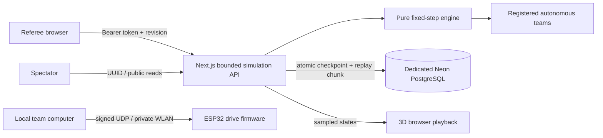

# ADR-001: Deterministic batches, Neon checkpoints, and a Turborepo monorepo

Status: accepted for the first functional lab, 2026-11-17. User selected Next.js, Vercel and Neon, then explicitly requested Turborepo. The scope is an educational 3×3 match with registered autonomous teams and referee controls, without physical validation.

## Decision

Use a pure TypeScript 60 Hz motor/ball engine, versioned observations and wheel commands in a separate package, and trusted registered team strategies. The Next.js server owns persistent match state. An authenticated request advances 1–120 ticks, samples at 10 Hz, and commits state and replay chunk in one conditional PostgreSQL statement. Revision conflicts return 409; no process memory is authoritative. The 3D browser renders these computed frames. A clearly labeled client-only preview works without a database.

The request budget is 10 seconds, deliberately below provider plan-dependent maxima. No request waits for simulated wall time. No new continuous-service provider is required. An operator drives batch requests; no operator means no advancement. An external scheduler could drive requests later but is not silently provisioned.

Use npm workspaces and Turborepo, with direct TypeScript source exports for internal packages and Next.js `transpilePackages`. Keep browser-safe simulation/protocol entrypoints separate from the Node-only HMAC radio and SQL drivers. Task dependencies follow package dependencies; TypeScript config and test config invalidate shared caches. Tests that touch persistence are uncached. Do not cache secrets in task outputs.

## Data flow

## Alternatives and trade-offs

A permanent WebSocket simulation process would require lifecycle/reconnection/ownership design and plan-dependent limits. Current Vercel documentation now advertises WebSocket support, so “Vercel never supports WebSockets” is no longer a safe blanket assertion. Connections still have invocation limits; bounded HTTP keeps this design portable and simple. Client-only simulation would not provide authoritative server matches. Tick-by-tick SQL writes would be expensive and unnecessary. A monolith with relative imports was sufficient initially but did not meet the user's requested monorepo structure.

Persisted state is deterministic for the same engine version and JavaScript runtime; cross-language/CPU floating-point bit identity is not promised. Store engine/protocol version in state and preserve application revisions for long-term replay compatibility. Batches are atomic, replay reads are bounded, and no raw tick is stored individually. Frame storage is still proportional to simulation duration; authenticated operators and a future retention policy control growth.

The lab uses a single operator secret and public UUID-based reads. There is no arbitrary team execution, browser-to-motor coupling, or live physical control in the web app. The bridge is explicitly a separate local tool. See SECURITY.md for remaining operational limits.

## Official references checked

- [Vercel Function limits](https://vercel.com/docs/functions/limitations) and [duration](https://vercel.com/docs/functions/configuring-functions/duration).
- [Vercel WebSocket general availability](https://vercel.com/changelog/websocket-support-is-now-generally-available).
- [Neon serverless driver](https://neon.com/docs/serverless/serverless-driver): HTTP queries suit short server requests; parameterized queries carry data separately from SQL.
- [Turborepo repository structure](https://turborepo.com/docs/crafting-your-repository/structuring-a-repository) and [task configuration](https://turborepo.com/docs/reference/configuration).
