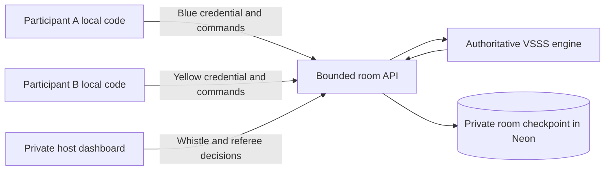

# ADR 0002: private remote competition rooms

## Status
Accepted implementation direction: the user explicitly chose local participant programs with private team credentials.

## Context
Two remote participants need to connect their own code to the same authoritative VSSS simulation. The existing Vercel/Neon installation must remain usable without an always-on process, code-upload service or paid infrastructure upgrade. Room access must not grant the global operator secret or allow a team to command its opponent.

## Decision
Use private, expiring PostgreSQL room checkpoints and bounded HTTPS turns. An operator creates a room and receives separate host, spectator and team invitations. Participants claim a team using its invitation and their own randomly generated access key. All persistent secrets are hashed. Credentials travel in authorization headers or bounded POST bodies, never URLs.

Each turn collects validated commands for both teams. The second submission advances six 60 Hz ticks and atomically commits the checkpoint. Optimistic revision checks retry a competing merge, while a monotonically increasing room turn rejects stale submissions. No participant can advance multiple turns alone. Missing/disconnected participants freeze advancement, rather than reusing old commands. The host controls whistles, pauses and referee decisions. Clients use the same observation frame.

The existing public match endpoints cannot read room state: rooms use their own table and authenticated routes. Arbitrary participant source runs only on their computers. Provide Koativa/Circuit Node clients and a documented language-independent HTTP contract.

## Alternatives
WebSockets and an always-on simulation worker offer smoother real-time operation but require another hosting service and lifecycle/queue handling. Uploaded source requires a reviewed isolated execution service and resource controls. Browser-supplied authoritative state would undermine fair competition. These alternatives are outside this change.

## Consequences and limits
HTTP lockstep favors correctness and equal turns over wall-clock speed. Network and database latency can make simulated time run slower than real time. The host keeps a room dashboard open; participant programs poll while stopped. Invitations are private capabilities: distribute them only to intended participants. Single-operator creation limits anonymous room creation; expiry bounds access duration. No public lobby, ranking, arbitrary-code execution or anti-cheat certification is claimed.

